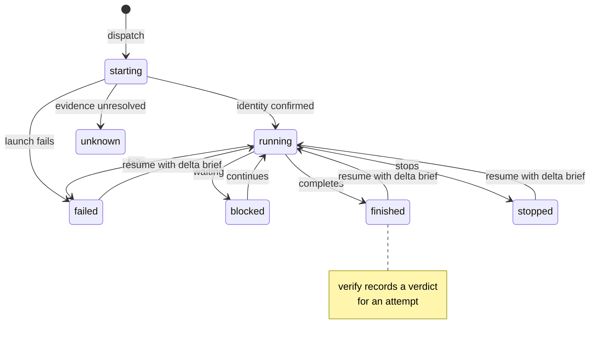

# herder

herder is a Rust CLI that lets your coding agent delegate work to Codex, Vibe or Claude workers, track them, and verify their work independently. People can use it directly too.

Here a stub worker claimed success but edited `config.toml`, outside the `src/` path it was allowed to touch. `verify` catches it:

<picture>
  <source media="(prefers-color-scheme: dark)" srcset="docs/assets/demo-dark.png">
  
</picture>

<details>
<summary>Output as text</summary>

```text
$ herder verify outside-src --check 'true'
FAIL  outside-src  attempt 1
  scope  failed (exit 1)
    config.toml changed outside allowed paths (src/) since cf2e240.
    Changed files: config.toml.
    Pre-existing and unchanged: none.
  check  collect_evidence.sh  ok
  check  true  ok

$ herder ls
ID                    NAME         GOAL  EXECUTOR  STATE     ATTEMPT  MODEL
20261118-164821-c473  outside-src  -     codex     finished  1        -
20261118-164822-5804  crashed      -     codex     failed    1        -

codex: 2 runs (failed 1, finished 1)
```
</details>

## Use it from your agent

The universal macOS binary is signed with a Developer ID and notarized by Apple. You also need bash, jq, perl, git and your executor CLIs installed.

```sh
release=https://github.com/Shaance/herder/releases/latest/download
curl -fsSL "$release/herder-macos-universal.tar.gz" | tar -xz herder
sudo mv herder /usr/local/bin/   # or any directory on PATH

# Or build from source with Rust:
cargo install herder
```

Clone the repository and run the line for your host to link the [herder skill](skill/SKILL.md). Keep the clone in place; if a host already has a `herder` skill, inspect that entry before replacing it.

```sh
git clone https://github.com/Shaance/herder.git
cd herder
# Claude Code
mkdir -p ~/.claude/skills && ln -s "$PWD/skill" ~/.claude/skills/herder
# Codex
mkdir -p ~/.codex/skills && ln -s "$PWD/skill" ~/.codex/skills/herder
# Vibe
mkdir -p ~/.vibe/skills && ln -s "$PWD/skill" ~/.vibe/skills/herder
```

Allow your agent to run herder with normal user access, since herder starts executor CLIs that use the network and their own configuration:

- Claude Code: allow `Bash(herder:*)` in settings, or approve commands when asked.
- Codex: add `prefix_rule(pattern=["herder"], decision="allow")` to `~/.codex/rules/default.rules`.
- Vibe: approve commands when asked, or run the session with the `auto-approve` agent.

Then ask your agent, for example:

> Have Codex add a module comment to `src/lib.rs` with herder, then verify it with `cargo test`.

The skill teaches your agent the brief format and the dispatch, wait, report and verify loop, so you never need to write a brief yourself. The agent inspects the changes and runs verification; you or the coordinating agent decide what to do with the evidence.

## Quick start

You also need bash, jq, perl, git and the executor CLIs you use (`codex`, `vibe` and/or `claude`). This example checks Codex; change the executor if needed. To build from source instead, install Rust and run `cargo install herder`.

```sh
release=https://github.com/Shaance/herder/releases/latest/download
curl -fsSL "$release/herder-macos-universal.tar.gz" | tar -xz herder
sudo mv herder /usr/local/bin/
herder doctor --executor codex
```

<details>
<summary>Run it by hand (without an agent)</summary>

Adapt this brief to your repository and save it outside the repository so the brief itself does not affect scope verification. Pass the same authorized paths to dispatch with `--path`:

```sh
cat > "${TMPDIR:-/tmp}/herder-task.md" <<'BRIEF'
<task>Add a module comment to src/lib.rs. Rejected alternative: separate docs.</task>
<workstream_contract>Work alone.</workstream_contract>
<implementation_authority>Authorized paths: src/.</implementation_authority>
<action_safety>Do not commit or push.</action_safety>
<default_follow_through_policy>Finish and check the task.</default_follow_through_policy>
<verification_loop>Run cargo test.</verification_loop>
<economy_contract>Keep the change small.</economy_contract>
<structured_output_contract>Report changes and check results.</structured_output_contract>
BRIEF
```

From the repository to be changed, dispatch the worker and use its unique name in the remaining commands:

```sh
herder dispatch --executor codex \
  --brief "${TMPDIR:-/tmp}/herder-task.md" \
  --repo . --name module-comment --path src/
herder wait module-comment
herder report module-comment
herder verify module-comment --check 'cargo test'
```

Wait also returns for blocked or failed runs; inspect `herder status module-comment` before continuing if the worker has not finished. Review the evidence before publishing. For review mode, use `--mode review` and include `<task>`, `<action_safety>`, `<default_follow_through_policy>` and `<structured_output_contract>` blocks; the brief must require read-only behavior.

</details>

## Why

A worker can run in the background for hours. You need to know whether it is still working, stopped, or changed files outside its brief. A worker's report that tests passed is its own claim.

herder keeps a durable record for each worker. It queries Claude's CLI or uses the Codex and Vibe status scripts to inspect executor evidence; when that evidence is unresolved, it reports `unknown` with a cause. Verification checks changed files against the authorized `--path` prefixes you supply and runs the check commands you choose.

## How it works



The arrows show common observations; `unknown` can occur whenever evidence is unresolved. A successful resume starts a new attempt on a recorded session, and verification records a verdict separately from the lifecycle; see the [reference](docs/reference.md) for the rules and [architecture](docs/architecture.md) for the implementation.

## Concepts

| Term | Meaning |
| --- | --- |
| Run | A recorded worker and its lifecycle, identified by a run ID or unique name. |
| Goal | An optional label used to group and list runs. |
| Attempt | A numbered launch or resume of a run; verdicts are recorded per attempt. |
| Brief | The instructions given to a worker; herder stores a copy. |
| Report | The worker's output for the current accepted attempt. |
| Verdict | A recorded pass or fail from verification for an attempt. |

## Commands

| Command | Purpose |
| --- | --- |
| `doctor` | Check executors, profiles and Rex. |
| `dispatch` | Lint a brief and launch a recorded worker. |
| `handoff` | Launch a worker with a plain continuation document. |
| `ls` | List runs with fresh executor status. |
| `wait` | Wait for any or all runs to settle. Exit 0 if every settled run at return is finished, or 1 if any failed, stopped, or blocked, or the wait times out. |
| `status` | Query a run's current executor status. |
| `report` | Read the current attempt's report. |
| `stop` | Stop the exact recorded worker. |
| `resume` | Resume a recorded session with a delta brief. |
| `verify` | Record scope and command verification. |

Use `herder <command> --help` for flags and examples. All commands accept `--json` with an `{ok, data, error}` envelope; exit codes are 0 for success, 1 for operational failure and 2 for usage error. See [JSON and exit codes](docs/reference.md#json-output-and-exit-codes) for details.

## Configuration

`HERDER_STATE_DIR` overrides the default `~/.local/state/herder`. `HERDER_SKILLS_DIR` replaces the embedded scripts with scripts from an ai-skills-shaped directory. For Claude, `--profile` takes precedence over `CLAUDE_CONFIG_DIR`, then Claude's default applies. See [storage](docs/reference.md#run-record-storage-and-locking) and [Claude profiles](docs/reference.md#claude-identity-profiles-and-resume).

## Optional: Rex

[Rex](https://superlogical.com) is a macOS terminal in invite-only public beta. In Rex, `--pane` opens a pane to attach to a Claude worker or wait for a Vibe or Codex worker. See [Rex panes](docs/reference.md#rex-panes-and-environment).

## Platform support

macOS is supported and tested in CI; Linux is untested.

## Development

See [CONTRIBUTING.md](CONTRIBUTING.md) for setup and pull request guidance.

```sh
cargo build --offline --locked
cargo test --offline --locked
cargo clippy --offline --locked --all-targets -- -D warnings
```

Tests use stub executors and temporary state, never real workers. Contract tests run the vendored launch and status scripts and require `jq`; set `HERDER_SKILLS_DIR` to test another ai-skills-shaped directory.

## Releasing

First, rename `## Unreleased` in `CHANGELOG.md` to `## X.Y.Z (YYYY-MM-DD)` for the GitHub Release notes, and add a new empty `## Unreleased` above it.
Bump `version` in `Cargo.toml`, run `cargo build` so `Cargo.lock` picks it up, commit the changes, and push a matching `vX.Y.Z` tag. The workflow publishes the signed GitHub Release and then the crate. If the crate job fails after the release succeeds, re-run only that job.

## License

Licensed under [MIT](LICENSE-MIT) or [Apache-2.0](LICENSE-APACHE).
