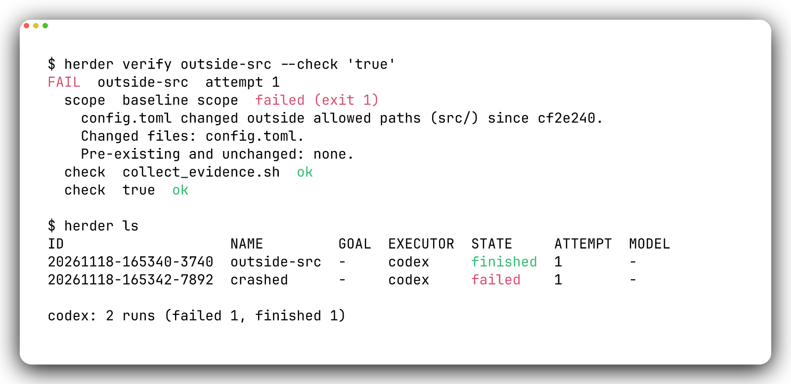
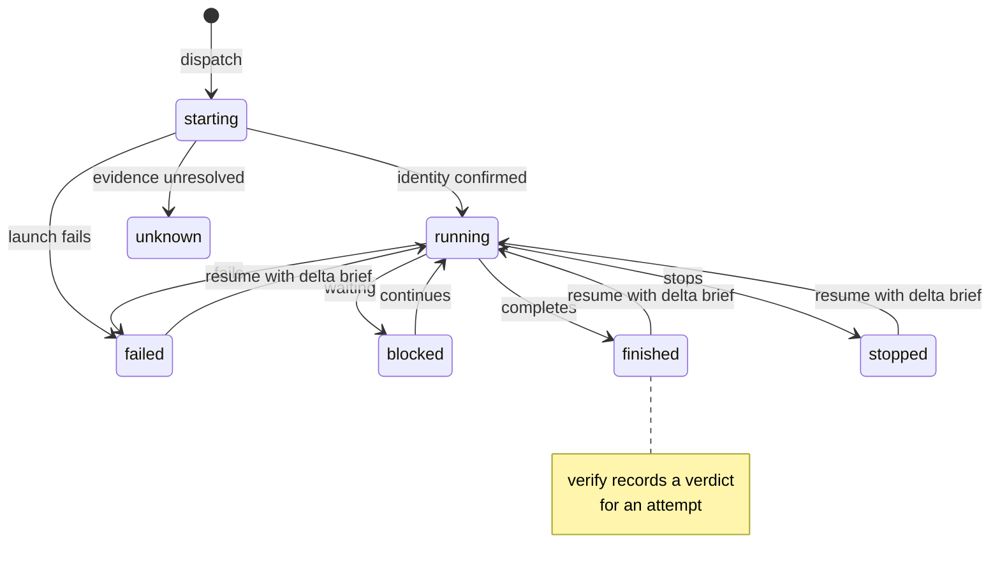

# herder

Herder is a local Rust CLI that lets you or your coding agent delegate work to Claude Code, Codex, and Mistral Vibe. Track each run, verify that edits stayed within the allowed paths, and run your own checks.

## Get a read-only Codex review from Claude Code

Set up the local Herder MCP server in Claude Code and confirm which worktree it sees before launching a worker. [MCP setup guide](mcp/README.md) · [First-use checkout prompt](mcp/README.md#check-your-registration)

You can also add the Herder skill to teach your agent when to use the registered tools or the CLI. [Skill setup](#add-the-herder-skill)

Once the checkout matches and you have approved Codex quota for this goal, try this prompt.

> Use Herder to ask Codex for a read-only review of this diff. Use `pre-merge` as the goal and pick a fresh run name. Look for regressions and missing tests, cite the relevant files and lines, and give me the Herder run ID.

Save the run ID. You can ask another session to read the same report when both clients use the same checkout and Herder state directory.

> Show me the report for run `<your run ID>`.

With Herder v0.5.0 or later, the agent can wait up to 30 seconds at a time for a result. To let it implement a change, register a dedicated clean worktree, prefixes for auditing Git-visible changes, and an executable that checks the result. [MCP writer setup](mcp/README.md#enable-a-writer-for-one-worktree)

## Verify a worker's changes

Here a stub worker claimed success but edited `config.toml`, outside the `src/` path it was allowed to touch. `verify` catches it:

<picture>
  <source media="(prefers-color-scheme: dark)" srcset="https://raw.githubusercontent.com/Shaance/herder/master/docs/assets/demo-dark.png">
  
</picture>

<details>
<summary>Output as text</summary>

```text
$ herder verify outside-src --check 'true'
FAIL  outside-src  attempt 1
  scope  failed (exit 1)
    config.toml changed outside allowed paths (src/) since cf2e240.
    Changed files: config.toml.
    Pre-existing and unchanged: none.
  check  collect_evidence.sh  ok
  check  true  ok

$ herder ls
ID                    NAME         GOAL  EXECUTOR  STATE     ATTEMPT  MODEL  EFFORT
20261118-164821-c473  outside-src  -     codex     finished  1        -      -
20261118-164822-5804  crashed      -     codex     failed    1        -      -

codex: 2 runs (failed 1, finished 1)
```
</details>

## Use it from your agent

Install herder with Homebrew on macOS (Apple Silicon or Intel):

```sh
brew install shaance/tap/herder
```

The tap and the signed, notarized macOS archive include `herder-mcp` starting with v0.4.0. You can also install the CLI alone from crates.io. Herder uses Bash, jq, Perl, Git and your executor CLIs.

```sh
release=https://github.com/Shaance/herder/releases/latest/download
curl -fsSL "$release/herder-macos-universal.tar.gz" | tar -xz herder
sudo mv herder /usr/local/bin/   # or any directory on PATH

# Or build and install the CLI from crates.io:
cargo install --locked herder
```

### Add the Herder skill

For personal use across projects, clone the repository and run the line for your host to link the [Herder skill](skill/SKILL.md). Keep the clone in place. If a host already has a `herder` skill, inspect that entry before replacing it.

```sh
git clone https://github.com/Shaance/herder.git
cd herder
# Claude Code
mkdir -p ~/.claude/skills && ln -s "$PWD/skill" ~/.claude/skills/herder
# Codex
mkdir -p ~/.codex/skills && ln -s "$PWD/skill" ~/.codex/skills/herder
# Vibe
mkdir -p ~/.vibe/skills && ln -s "$PWD/skill" ~/.vibe/skills/herder
```

For a team, add one copy to the repository that will use Herder. Codex and Vibe find it at `.agents/skills/herder`. Claude Code finds it through the relative link at `.claude/skills/herder`. From that team's Git root, with the skill paths still unused, run these commands.

```sh
mkdir -p .agents/skills .claude/skills
cp -R /path/to/herder/skill .agents/skills/herder
ln -s ../../.agents/skills/herder .claude/skills/herder
```

Commit the copy and the relative link together so they work in other checkouts.

### Run Herder from your agent

Allow your agent to run herder with normal user access, since herder starts executor CLIs that use the network and their own configuration:

- Claude Code: allow `Bash(herder:*)` in settings, or approve commands when asked.
- Codex: add `prefix_rule(pattern=["herder"], decision="allow")` to `~/.codex/rules/default.rules`.
- Vibe: approve commands when asked, or run the session with the `auto-approve` agent.

Then ask your agent, for example:

> Have Codex add a module comment to `src/lib.rs` with herder, then verify it with `cargo test`.

The skill teaches your agent the brief format and the dispatch, wait, report and verify loop, so you never need to write a brief yourself. The agent inspects the changes and runs verification; you or the coordinating agent decide what to do with the evidence.

## Quick start

You also need bash, jq, perl, git and the executor CLIs you use (`codex`, `vibe` and/or `claude`). This example checks Codex; change the executor if needed. To download the binary or build from source instead, see [Use it from your agent](#use-it-from-your-agent).

```sh
brew install shaance/tap/herder
herder doctor --executor codex
```

<details>
<summary>Run it by hand (without an agent)</summary>

Adapt this brief to your repository and save it outside the repository so the brief itself does not affect scope verification. Pass the same authorized paths to dispatch with `--path`:

```sh
cat > "${TMPDIR:-/tmp}/herder-task.md" <<'BRIEF'
<task>Add a module comment to src/lib.rs. Rejected alternative: separate docs.</task>
<workstream_contract>Work alone.</workstream_contract>
<implementation_authority>Authorized paths: src/.</implementation_authority>
<action_safety>Do not commit or push.</action_safety>
<default_follow_through_policy>Finish and check the task.</default_follow_through_policy>
<verification_loop>Run cargo test.</verification_loop>
<economy_contract>Keep the change small.</economy_contract>
<structured_output_contract>Report changes and check results.</structured_output_contract>
BRIEF
```

From the repository to be changed, dispatch the worker and use its unique name in the remaining commands:

```sh
herder dispatch --executor codex \
  --brief "${TMPDIR:-/tmp}/herder-task.md" \
  --repo . --name module-comment --path src/
herder wait module-comment
herder report module-comment
herder verify module-comment --check 'cargo test'
```

Wait also returns for blocked or failed runs; inspect `herder status module-comment` before continuing if the worker has not finished. While a Claude worker is still running, `herder wait` shows where to read its report as soon as a poll finds it. Review the evidence before publishing. For review mode, use `--mode review` and include `<task>`, `<action_safety>`, `<default_follow_through_policy>` and `<structured_output_contract>` blocks; the brief must require read-only behavior.

</details>

## Why

A worker can run in the background for hours. You need to know whether it is still working, stopped, or changed files outside its brief. A worker's report that tests passed is its own claim.

herder keeps a durable record for each worker. It queries Claude's CLI or uses the Codex and Vibe status scripts to inspect executor evidence; when that evidence is unresolved, it reports `unknown` with a cause. Verification checks changed files against the authorized `--path` prefixes you supply and runs the check commands you choose.

Claude workers give their report in their last reply. Herder saves it automatically, so a new dispatch only requires Claude to trust the repository.

## How it works



The arrows show common observations. `unknown` can occur whenever evidence is unresolved. A successful resume starts a new attempt on a recorded session, and verification records a verdict separately from the lifecycle. See the [reference](https://github.com/Shaance/herder/blob/master/docs/reference.md) for the rules and [architecture](https://github.com/Shaance/herder/blob/master/docs/architecture.md) for the implementation.

## Concepts

| Term | Meaning |
| --- | --- |
| Run | A recorded worker and its lifecycle, identified by a run ID or unique name. |
| Goal | An optional label used to group and list runs. |
| Attempt | A numbered launch or resume of a run; verdicts are recorded per attempt. |
| Brief | The instructions given to a worker; herder stores a copy. |
| Report | The worker's output for the current accepted attempt. |
| Verdict | A recorded pass or fail from verification for an attempt. |

## Commands

| Command | Purpose |
| --- | --- |
| `doctor` | Check executors, profiles and Rex. |
| `dispatch` | Lint a brief and launch a recorded worker. |
| `handoff` | Launch a worker with a plain continuation document. |
| `ls` | List runs with fresh executor status and requested effort after the model. |
| `wait` | Wait for any or all runs to settle. Exit 0 if every settled run at return is finished, or 1 if any failed, stopped, or blocked, or the wait times out. |
| `status` | Query a run's current executor status. |
| `context` | Show the configured directory, Git worktree root, branch, HEAD, and Herder state directory. |
| `report` | Read the current attempt's report. |
| `stop` | Stop the exact recorded worker. |
| `resume` | Resume a recorded session with a delta brief. |
| `verify` | Record scope and command verification. |

Use `--effort <LEVEL>` on `dispatch` or `handoff` to request reasoning effort for Codex or Claude. Use `herder <command> --help` for flags and examples. All commands accept `--json` with an `{ok, data, error}` envelope. Exit codes are 0 for success, 1 for operational failure and 2 for usage error. See [JSON and exit codes](https://github.com/Shaance/herder/blob/master/docs/reference.md#json-output-and-exit-codes) for details.

## Configuration

`HERDER_STATE_DIR` overrides the default `~/.local/state/herder`. `HERDER_SKILLS_DIR` replaces the embedded scripts with scripts from an ai-skills-shaped directory. For Claude, `--profile` takes precedence over `CLAUDE_CONFIG_DIR`, then Claude's default applies. See [storage](https://github.com/Shaance/herder/blob/master/docs/reference.md#run-record-storage-and-locking) and [Claude profiles](https://github.com/Shaance/herder/blob/master/docs/reference.md#claude-identity-profiles-and-resume).

## Terminal resume

An interactive `herder wait` for a confirmed Claude worker or one Codex or Vibe run can reopen the same recorded run after a restart in a terminal that supports the Program Resume Protocol (OSC 7577). See [terminal resume](https://github.com/Shaance/herder/blob/master/docs/reference.md#terminal-resume).

## Optional: Rex

[Rex](https://superlogical.com) is a macOS terminal in invite-only public beta. In Rex, `--pane` opens a pane to attach to a Claude worker or wait for a Vibe or Codex worker. See [Rex panes and restore setup](https://github.com/Shaance/herder/blob/master/docs/reference.md#rex-panes-and-environment).

## Platform support

macOS is supported and tested in CI; Linux is untested.

## Development

See [CONTRIBUTING.md](https://github.com/Shaance/herder/blob/master/CONTRIBUTING.md) for setup and pull request guidance.

```sh
cargo build --offline --locked
cargo test --offline --locked
cargo clippy --offline --locked --all-targets -- -D warnings
```

Tests use stub executors and temporary state, never real workers. Contract tests run the vendored launch and status scripts and require `jq`; set `HERDER_SKILLS_DIR` to test another ai-skills-shaped directory.

## Releasing

Move the release notes from `## Unreleased` to `## X.Y.Z (YYYY-MM-DD)` in `CHANGELOG.md`. Bump both package versions and refresh both lockfiles with `cargo check` and `cargo check --manifest-path mcp/Cargo.toml`. Commit the release and create a matching local `vX.Y.Z` tag.

Both crates publish through the GitHub Actions Trusted Publisher for `Shaance/herder`, workflow `release.yml`, environment `crates-io`. [crates.io Trusted Publishing](https://crates.io/docs/trusted-publishing)

Push the matching release tag to start the workflow. After the macOS build, the GitHub release job publishes and verifies the archive before the tap and crate jobs start. A registry job accepts an existing version only when crates.io reports an unyanked archive whose SHA-256 matches the package built from that tag.

Use **Re-run failed jobs** for publication retries while the signed build artifact is retained. If a draft remains, compare it with that artifact. Finish publishing it in GitHub if both assets match, or remove the unpublished draft after inspecting it and rerun the publication job. A public release with conflicting assets requires maintainer review.

## License

Licensed under [MIT](LICENSE-MIT) or [Apache-2.0](LICENSE-APACHE).
